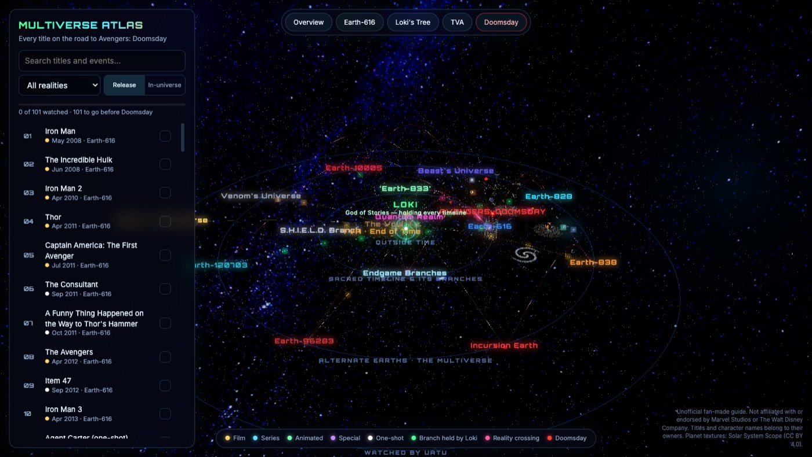
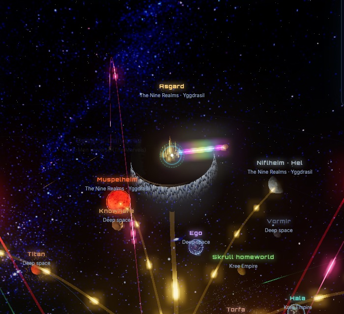
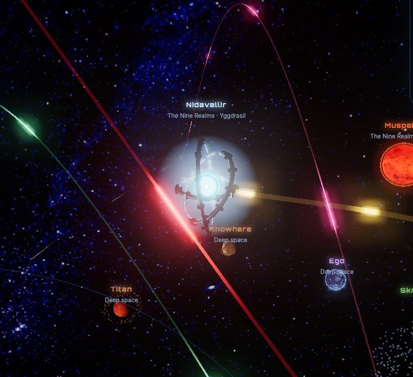
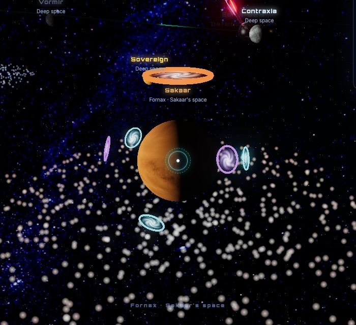
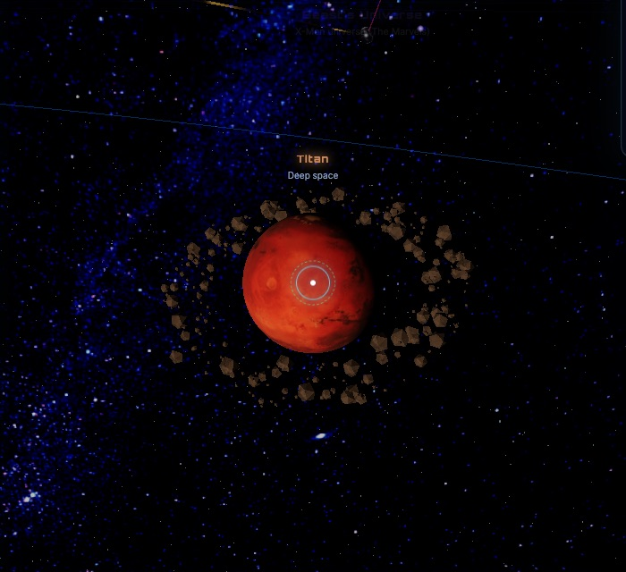
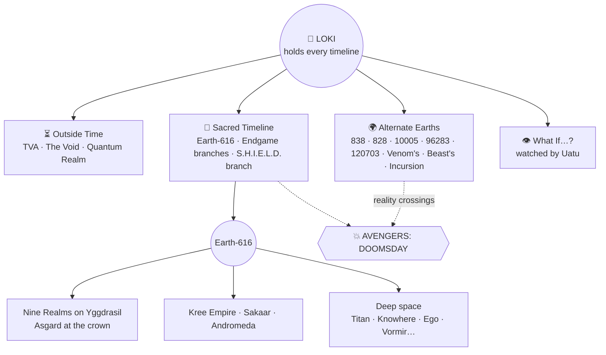
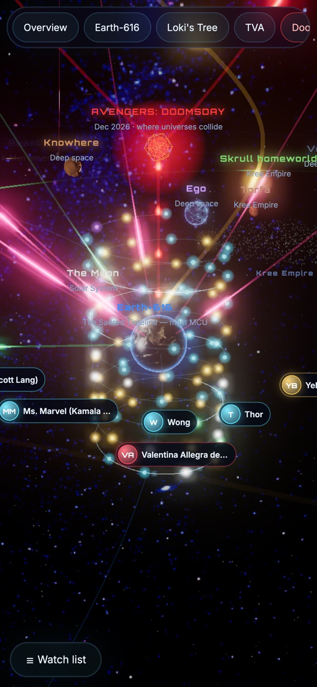
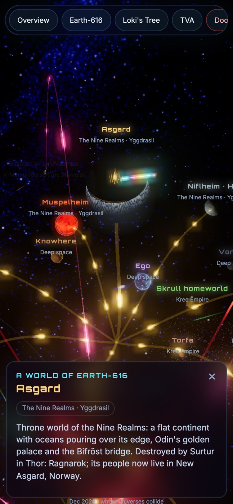

<div align="center">

# 🌌 MULTIVERSE ATLAS
### *The Road to Avengers: Doomsday, mapped in 3D*

**Every film and series. Every Earth. Every timeline crossing. One universe you can fly through.**

[](https://starlordshady001.github.io/mcu-multiverse/)


<a href="https://starlordshady001.github.io/mcu-multiverse/"></a>

</div>

---

> *"Burdened with glorious purpose."* At the centre of everything, **Loki holds the timelines**. Each branch of his tree reaches a different Earth. Each Earth carries a helix of every story that happened there, ordered by in-universe year. Where realities collide, glowing arcs show the crossing. And all of it leads to one red, pulsing point: **Avengers: Doomsday**.

## ✨ What's inside

<table>
<tr>
<td width="50%" valign="top">

### 🌳 Loki's tree and the rings of reality
Realities orbit the God of Stories on four rings:
**Outside Time** (TVA, the Void, the Quantum Realm) → **the Sacred Timeline and its branches** → **the Alternate Earths** (838, 828, 10005, the Spider-Verse Earths…) → **What If…?**

</td>
<td width="50%" valign="top">

### 🧬 101 titles on time helixes
From *Iron Man* (2008) to *VisionQuest* (2026), every film, series, one-shot and special sits on its Earth's helix by in-universe year. Tick them off as you watch; progress stays in your browser.

</td>
</tr>
<tr>
<td valign="top">

### 💥 Reality crossings
Twenty glowing arcs trace every jump between universes: No Way Home's Spider-Men, Deadpool & Wolverine, the Fantastic Four's arrival, the Illuminati, and the threads that all converge on **Doomsday**.

</td>
<td valign="top">

### 🦸 Where everyone is right now
87 heroes, antiheroes and villains ring their Earths, each with actor, status (🟢 alive · 🔴 fallen · 🟡 captive · ⚪ unknown) and current whereabouts. Kingpin is Mayor. Zemo's in the Raft. Doom waits on Earth-828.

</td>
</tr>
</table>

## 🪐 Earth-616 and its worlds

Earth-616 isn't alone. Fly close and its whole cosmos opens up around it: **the Nine Realms** hanging from Yggdrasil, **the Kree Empire**, **Sakaar's** wormhole space, **Andromeda's** Nova Empire, and the deep-space worlds of the Guardians.

<table>
<tr>
<td width="50%"><br><b>Asgard</b>: a floating continent, oceans spilling into space, Odin's golden palace and the rainbow Bifröst</td>
<td width="50%"><br><b>Nidavellir</b>: the dwarven forge, giant rings turning around a neutron star</td>
</tr>
<tr>
<td><br><b>Sakaar</b>: the Grandmaster's junk world, ringed by swirling wormholes</td>
<td><br><b>Titan</b>: Thanos's ruined home, circled by the moon he pulled down</td>
</tr>
</table>

Also on the map: Muspelheim's lava, Knowhere (the Celestial's severed head), Ego the living planet, Vormir, Xandar, Morag, Hala, Sovereign, Contraxia, Zen-Whoberi, Counter-Earth and more. That's **30 worlds** in all.

## 🗺️ How the universe is laid out



## 📱 Works on your phone too

<table>
<tr>
<td width="28%"></td>
<td width="28%"></td>
<td valign="middle">

Pinch to zoom, drag to orbit, **tap anything** to fly to it. The watch list and info cards slide up as bottom sheets, the camera keeps your selection in view above them, and labels make room for each other so nothing piles up.

</td>
</tr>
</table>

## 🎮 Controls

| | 🖱️ Desktop | 📱 Phone / tablet |
|---|---|---|
| Zoom | Scroll (zooms toward the cursor) | Pinch |
| Orbit | Drag | One-finger drag |
| Pan | Right-drag | Two-finger drag |
| Fly to a world or title | Click it | Tap it |
| Focus one reality | Pick it in the dropdown, or click its planet: it glows and everything else fades | Same |
| Back to the overview | Double-click empty space or press **Esc** | **Overview** button |

Deep links open straight onto a reality: [`#616`](https://starlordshady001.github.io/mcu-multiverse/#616) · [`#828`](https://starlordshady001.github.io/mcu-multiverse/#828) · [`#10005`](https://starlordshady001.github.io/mcu-multiverse/#10005) · [`#tva`](https://starlordshady001.github.io/mcu-multiverse/#tva)

## 🚀 Run it locally

No install, no build. Just serve the folder (textures can't load from a double-clicked file):

```bash
git clone https://github.com/StarLordShady001/mcu-multiverse.git
cd mcu-multiverse
python3 -m http.server 8765
# open http://localhost:8765
```

## 🧩 Add to the multiverse

Everything is data. Edit a file, refresh, done.

| To add… | Edit | What to change |
|---|---|---|
| A film or series | `data.js` | Append a row to `TITLES` |
| A reality | `data.js` | Add to `EARTHS` (ring, angle, size, colour) |
| A crossover | `data.js` | Add to `COLLISIONS` |
| A hero or villain, or move one | `data.js` | `CHARACTERS` (side, status, whereabouts) |
| A planet | `planets.js` | Add a row to `PLANETS` |

Then run `node check.mjs`. It catches broken references before anyone sees them:

```
ok: 30 worlds, 101 titles, 16 earths, 20 collisions, 87 characters
```

<details>
<summary><b>🎨 Licensed images and 3D models (drop-in, no code changes)</b></summary>

- **Key art per title:** `assets/art/001.jpg` … `101.jpg` (watch-order number). Portrait 2:3, about 1000×1500.
- **Character portraits:** `assets/characters/<id>.png`, using the ids in `CHARACTERS` (e.g. `kingpin.png`, `doom.png`). Square, about 512×512. Until one exists, a coloured initials badge is shown.
- **Exact 3D planet models:** put a `.glb` at `assets/models/<id>.glb` (e.g. `asgard.glb`) and add the id to `MODELS` in `planets.js`. It replaces the built-in model, scaled to fit.
- **Copyright line:** set `LEGAL` in `data.js`.

Only add images or models you have the rights to publish. This repository is public.

</details>

<details>
<summary><b>⚙️ Under the hood</b></summary>

- **[three.js](https://threejs.org) r160** from a CDN, with no bundler and no framework. Just `index.html` plus three data/model files.
- Custom shaders: a day/night Earth lit by Loki's tree (city lights on the dark side, ocean glint), fresnel atmospheres, flowing light pulses along every branch, Asgard's falling oceans, the rainbow Bifröst and Sakaar's swirling wormholes.
- Unreal bloom post-processing, a CSS2D label layer and a custom 3D cursor.
- Hand-built procedural models for Asgard, Nidavellir, Muspelheim, Knowhere, Sakaar, Titan and Ego.
- Phones get lighter rendering (fewer stars, simpler spheres, capped pixel ratio) to stay smooth.

</details>

## 🙏 Credits

- Planet textures: **[Solar System Scope](https://www.solarsystemscope.com/textures/)**, CC BY 4.0
- Earth, Moon and sky imagery: NASA Blue Marble–derived textures distributed with three.js
- Planet list cross-checked against *All 43 Planets in the Marvel Cinematic Universe Explained* (Generation Films) and the *Marvel's cosmic connections* chart

---

<div align="center">
<sub><b>Unofficial fan-made guide.</b> Not affiliated with or endorsed by Marvel Studios or The Walt Disney Company. Titles and character names belong to their owners. No film images or likenesses are included.</sub>
<br><br>

**[▶ Enter the multiverse](https://starlordshady001.github.io/mcu-multiverse/)**

</div>
